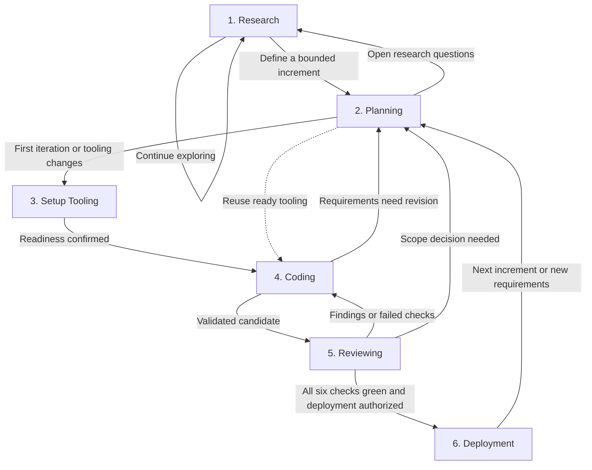

# Development Process

> **Status: Working draft.** All six stages are described below. Reviewing defines six checks on the final candidate; deployment requires separate user authorization.

## Overview

The development process has six stages:

1. **Research** — explore a problem, capture concepts, and form opinions.
2. **Planning** — define a bounded specification of work and derive agent-ready delivery documents.
3. **Setup Tooling** — prepare the agent and project environment for the chosen product and technology.
4. **Coding** — implement the planned work.
5. **Reviewing** — review the implementation.
6. **Deployment** — deliver the software product or update to a runtime environment.

The process moves from open-ended exploration toward a deployed software product. It is not a single pass through six fixed gates. Research may continue for as long as it is useful, and Planning, Coding, and Reviewing repeat across successive iterations. Setup Tooling normally happens once, after the first planning iteration, and is revisited when the product's needs or technology change. Deployment delivers the resulting product or update; later iterations can lead to further deployments.

A runtime environment may be a server, a website's hosting environment, a desktop, or a laptop. Deployment is not limited to web applications or server-based products.

`process.md` defines stage responsibilities and required gates. Skills, tooling guides, and runbooks explain how to execute them; they must not silently move a gate to another stage or weaken its policy.

Before entering a stage, confirm that its required skills are available under their exact names. Planning requires `grill-with-docs` and `rate-userstories`; Coding requires `code-simplifier` and `create-verification-skill` or `maintain-verification-skill`; Reviewing requires `pr-code-review`, `ac-review`, and the project's verification skill. A harness may namespace these names (for example a plugin prefix); [harnesses.md](harnesses.md) records the accepted form for each supported harness. Resolve missing capabilities before relying on them. Local skill source lives under `skills/<skill-name>/SKILL.md`; explicitly load it or configure the agent's supported discovery mechanism rather than assuming this folder is automatically registered.

The process is harness-neutral. Agent-harness specifics (installation, delegation, the supervisor channel, interviews, tool names) live only in [harnesses.md](harnesses.md) and the generated role agents; this document and the runbooks must not depend on any one harness.

## Process flow



## Progressive loading and routing

Start with the parent-only [development-process router](skills/development-process/SKILL.md). Resolve the process root from that skill's directory (`../..`), separately from the target project root. For process-library maintenance, edit only the requested sources; do not execute application stages merely because these files describe them. See the checkout's [bootstrap](AGENTS.md) and [first-use walkthrough](README.md).

Load this Overview, the [shared contract](#shared-roles-and-parent-handoff-contract), and the [external artifact policy](#external-artifacts-and-review-records), then the assigned stage in full, including its subsections and transition/completion rules. Locate headings and read bounded ranges; links/anchors do not scope a file read automatically. Never substitute a remembered summary for missing required policy. Load only the assigned [Research](runbooks/stages/01-research.md), [Planning](runbooks/stages/02-planning.md), [Setup](runbooks/stages/03-setup-tooling.md), [Coding](runbooks/stages/04-coding.md), [Reviewing](runbooks/stages/05-reviewing.md), or [Deployment](runbooks/stages/06-deployment.md) runbook and references needed for that task. Runbooks are execution aids; the gates and transitions here remain authoritative.

The parent confirms ambiguous stage/feature scope with the user, routes bounded tasks, and pauses at user-approved stop points; it does not autonomously march through all six stages. Research and initial Planning need neither existing planning documents nor a target `AGENTS.md`; Setup bootstraps those project instructions. Before an artifact agreement exists, do not write runtime artifacts without explicit approval; conversation and authorized planning source work may continue.

## Shared roles and parent handoff contract

For work creating or consuming planning documents, also load the [planning-location policy](#planning-directory-planning_dir). Research without planning inputs does not require a planning directory.

The parent owns routing, delegation, and relaying user interviews/approvals by default. Role ownership is explicit: PLANNER writes Planning documents; CODER owns Setup Tooling, Coding, and source remediation; RESEARCHER supplies evidence; REVIEWER independently checks candidates; INFRA supplies scoped infrastructure/CI support and separately authorized delivery. Infra is not the default Setup owner. These reusable leaf profiles do not delegate; remove spawning tools where the harness supports it, otherwise retain the leaf responsibility as a mandatory instruction and disclose that limitation.

Each parent brief must supply:

- Stage/mode and bounded scope, absolute process-root and target project-root paths, authoritative process sections/runbook, and stage-appropriate inputs. Supply target `AGENTS.md`, the resolved absolute `PLANNING_DIR` and its three document paths when relevant, following [planning-location policy](#planning-directory-planning_dir). Mark absent initial Research/Planning inputs as not-yet-created, not a completion gate. Setup creates/updates target `AGENTS.md`.
- Allowed edits and prohibited side effects; exact candidate/base/range and included working-tree changes where evidence must be candidate-scoped.
- Required skill file paths and actual tool/provider capabilities, not just extension/package names.
- Approved external artifact root, absolute `ARTIFACT_DIR`, output classes, access/retention/cleanup policy, and any ledger permission.
- Result recipient, required evidence, completion criteria, and decisions/authorizations already obtained (with their boundaries).

Global role definitions use these supplied project/process paths; do not assume a relative `../process.md`. Explicitly read applicable `SKILL.md` files and their required references before executing them. An inherited or listed skill catalog exposes names, not executed instructions; a repository `skills/` directory is not automatically discovered. Missing required skills or tools block the affected work. Where a harness supplies per-role tool allowlists, they are strict: installed extensions do not override them. Where it does not, role/edit boundaries remain mandatory instructions, not enforced tool isolation or separate sandboxes. Preflight and disclose the distinction; work requiring enforced isolation is blocked if unavailable. A named tool requires a loaded provider. Harness-specific provider and acceptance settings are documented in [harnesses.md](harnesses.md); none of them grants sandboxing or permission.

Children use their harness's supervisor channel (see [harnesses.md](harnesses.md)) for parent decisions, structured interviews, and material remediation/handoff coordination; wait for decision/interview replies and never invent user approval. The parent conducts or relays interviews as the harness section specifies. A supervisor channel may be native messaging or a documented stop-and-return exchange: the child returns questions, the parent obtains answers, and the same child resumes the bounded task. Message delivery and elapsed time are not answers or approval. If neither mechanism is available, disclose the blocker. Routine completion returns to the brief's recipient in conversation, not an unsolicited report. Skill instructions cannot widen edit boundaries or grant leaf delegation; inspect facts directly or ask the parent to route additional work.

Assign one writer per checkout and one serial live-verification owner at a time; source readers remain read-only and do not drive shared application state. Use fresh child context at responsibility changes, especially independent review. Resume the same worker only for a bounded, coherent ongoing task; fork is exceptional when history is genuinely needed, not a token-saving default. Use distinct candidate-scoped coder and reviewer sessions: coder owns source/PoC/test/fix mutations, reviewer independently inspects and executes approved checks. For a multi-step subagent workflow, the parent uses the delegation mechanism documented for its harness in [harnesses.md](harnesses.md) and preflights exact agents, skills, tools, and loaded providers. Failed delegation blocks the lane; do not silently switch to generic CLI or alternate delegation. The parent inspects actual outputs and completion gates, not merely runtime success. Handoffs stay conversational or use preapproved external evidence; no new mandatory handoff files or status reports. Refresh candidate identity and affected evidence after changes. No stage grants installation (especially system/global configuration), commits, pushes, or deployment authority implicitly; obtain explicit authorization for those actions.

## 1. Research

### Purpose

Research is a space for exploring a problem before committing to a defined piece of work. It is deliberately open-ended: the user can investigate ideas, capture high-level concepts, compare possibilities, and form opinions without needing to produce a specification or delivery plan.

Research is not Planning. Its purpose is to develop understanding, not to decide exactly what an agent should build.

### Activities

Research may include:

- Exploring the problem and the people affected by it.
- Gathering references, examples, and inspiration.
- Investigating existing products, technologies, or approaches.
- Recording questions, assumptions, concepts, and emerging opinions.
- Discussing possibilities with agents without committing to implementation.

### Outputs and transition

There are no required deliverables, fixed completion criteria, or prescribed duration for Research. Notes and other material may accumulate, but they are not mandatory outputs.

The user may remain in Research until they are ready to define a specific piece of work. Moving into Planning means choosing something concrete to specify; it does not require every research question to have been answered.

## 2. Planning

### Purpose and scope

Planning is performed by the user with PLANNER as the document writer; the parent relays interviews and user decisions. It turns an idea or problem into a **specification of work** and the supporting documents needed to implement it. PLANNER owns the assigned `PLANNING_DIR/specification.md`, `PLANNING_DIR/user-stories.md`, and `PLANNING_DIR/build-plan.md` only, not product, test, or configuration writes. Additional ADR/glossary source requires explicit approved scope; no skill implicitly grants it.

Each planning iteration should cover a small, verifiable increment rather than the entire software product. A six-week project should not be handed to a coding agent as one undivided specification. Even at this initial stage, the work should be broken into smaller modules that can be implemented and verified independently where practical.

Planning must state both what is included and what is excluded. For example, an initial web application specification may explicitly exclude billing-system integration and defer it to a later iteration. An exclusion makes the boundary clear; it is not an implicit commitment to deliver that feature now.

### Required documents

Every execution of Planning produces three documents:

1. **Specification of work** — the human-readable definition of the feature or set of features.
2. **Epics and user stories** — an agent-oriented breakdown with verifiable acceptance criteria, using the [LinearStories format](https://linearstories.com/llms.txt).
3. **Build plan** — an ordered list describing the sequence in which the coding agent should implement the user stories.

### Recommended folder structure

#### Planning directory (`PLANNING_DIR`)

`PLANNING_DIR` is the absolute directory holding one increment's three canonical documents. Use the location supplied in the parent brief, otherwise the applicable target `AGENTS.md` setting, otherwise the default `<project-root>/docs/<feature-name>/`. Choose a descriptive feature name, such as `account-registration`. With no override, the default repository layout is unchanged:

```text
docs/<feature-name>/
├── specification.md
├── user-stories.md
└── build-plan.md
```

`specification.md` is the source of truth; derive `user-stories.md` and `build-plan.md` from it and keep them aligned.

The parent may instead supply an absolute directory outside the checkout. Record the resolved `PLANNING_DIR`, all three absolute file paths, and authorized access in every relevant brief; do not rediscover the current increment by scanning old documents. A brief's planning selection takes precedence over the project setting for location only. It grants no additional access or authority; conflicts with project access or authority rules block affected work until the parent resolves them.

Resolve the project root, planning directory, and document paths canonically, including symlinks. For a not-yet-created directory or file, resolve its nearest existing ancestor and revalidate after creation. Reject document paths that escape the selected planning directory through symlinks; stop if paths or access change during a task. PLANNER alone may create or amend these documents during authorized Planning. All other roles read them without mutation; requirement changes return through the parent to Planning. If required external reads or planner writes are unavailable, report the blocker rather than copying files into the checkout or broadening permissions implicitly.

Externally supplied planning documents remain canonical outside the checkout: never copy them into it or commit them to the target repository. They are source inputs, separate from `ARTIFACT_DIR`; runtime output and artifact cleanup must not write to or remove them. `PLANNING_DIR` is a brief/project-instruction parameter, not a new configuration-file format or an environment variable that tools automatically discover.

### 2.1 Specification of work

The specification is the primary document for human consumption and review. It explains the intended outcome, the scope of the work, and the boundaries of the current iteration.

The agent generates the specification by taking the user through the **`grill-with-docs` skill**. The resulting document should capture:

- The problem being addressed and the intended outcome.
- The feature or set of features included in this iteration.
- The smaller, verifiable modules that make up the work.
- Explicit exclusions and work deferred to later iterations.
- Relevant decisions, actual user approvals and their scope, constraints, assumptions, and unresolved questions; never invent approval.
- Visual material needed to explain the concepts or intended experience.
- The intended build, installation, and runtime verification outcomes, including the target environment and required observable behavior.

Agree the CRAP production measurement scope and available language-specific coverage profile during Planning, then finalize the tooling in Setup. Identify known existing debt and unsupported measurement regions early. If the strict `<30` gate cannot be met within the proposed work, resolve the scope and necessary remediation with the user before Coding; do not silently exclude difficult functions or substitute a no-regressions policy.

Visual material may include diagrams, interface mockups, screenshots showing how the interface should look, and screenshots of other products. References to other products provide inspiration and context, not instructions to copy them.

### 2.2 Epics and user stories

The agent extracts epics and user stories from the specification. These are primarily written for agents and translate the human-readable intent into implementable, verifiable units of work.

The document must follow the [LinearStories agent reference](https://linearstories.com/llms.txt) and its [Markdown format](https://github.com/stackingturtles/linearstories/blob/main/docs/USER_STORY_FORMAT.md). In particular:

- Epics group related work and explain why it is needed.
- Epics use the exact `Epic` label and include a `### Why is this needed?` section; they do not contain acceptance criteria.
- User stories contain verifiable acceptance criteria under `### Acceptance Criteria`, expressed as Markdown checkboxes.
- Stories belonging to an epic reference it through `epic` metadata, using its exact local title or an existing Linear identifier.

After extraction, the agent runs the **`rate-userstories` skill** against the complete set of stories. The review evaluates acceptance-criteria quality and identifies tensions or contradictions within and across stories.

The agent then applies the review's recommendations to the user-stories document. Where a tension or contradiction requires a product or scope decision, the user resolves it and the specification is updated as needed. The derived stories must remain consistent with the specification rather than introducing unapproved requirements.

### 2.3 Build plan

The build plan is an ordered list of the user stories to implement. It is primarily written for the coding agent.

The order should account for dependencies and make clear which work must be completed before other work can begin. Entries should reference the corresponding stories so the coding agent can find their scope and acceptance criteria without treating the build plan as a separate requirements document.

The build plan is produced from the reviewed and revised stories, not from an earlier, unresolved version of them.

### Planning workflow

1. Define a bounded increment with the user through `grill-with-docs`.
2. Generate the specification of work, including its exclusions and supporting visuals.
3. Have the user review and refine the specification.
4. Extract epics and user stories in LinearStories format.
5. Review the stories with `rate-userstories`.
6. Apply recommendations and resolve tensions or contradictions with the user, updating the specification when required.
7. Bring the stories into alignment with the revised specification and repeat the story review as needed.
8. Produce the ordered build plan from the reviewed stories.

### Changes to planned work

The specification of work is the source of truth for human intent. Human changes are normally made there, rather than directly in the agent-oriented documents.

When the specification changes, repeat the derivation and review process: revise the epics and user stories, run `rate-userstories`, apply the resulting recommendations, and revise the build plan. Keep all three documents aligned before continuing implementation of the affected work.

## 3. Setup Tooling

### Purpose and timing

CODER owns Setup Tooling; INFRA may support parent-assigned infrastructure/CI slices. Setup Tooling prepares the development environment for the product defined during Planning. It normally takes place after the first planning iteration, because that work establishes the product's shape: for example, a web application, desktop application, or command-line tool.

This stage is typically executed once per project. Later iterations reuse the environment unless new languages, technologies, or delivery requirements make additional setup necessary.

Setup covers both the agent's capabilities and the tools available in the project environment. Installing agent extensions alone is not sufficient. Preflight actual registered tools/providers and usable stage skills. Required installations or system/global configuration changes need explicit authorization through the parent; missing permission blocks readiness, not permission to install automatically.

### Agent harness capabilities

The coding agent's harness must supply the capabilities listed for it in [harnesses.md](harnesses.md): delegation with fresh and resumable child context, a supervisor channel, structured user questions, web search/fetch for Research, and code editing and language-server support as applicable. A harness without a section there is unsupported until one is added.

### Role agents

The five role agents — `coder`, `infra`, `planner`, `researcher`, and `reviewer` — are generated from [roles/](roles/) for each supported harness and installed as that harness's section describes.

**Role agents must remain enabled whenever the coding agent is running.** Their availability is a baseline requirement of this process, not a feature enabled only for selected stages.

### Project tooling

Prepare the project environment with the tools appropriate to the selected languages and product type. These include:

- Language runtimes, compilers, and package or dependency managers, as applicable.
- Linters and formatters.
- Language servers and the corresponding Language Server Protocol (LSP) integration.
- Static analyzers.
- Build and test tools needed to implement and verify the planned work.
- Dependency vulnerability tools selected using `dependency-checking.md`.
- Pinned CRAP collectors, language adapters, and coverage providers required by Reviewing, configured using `runbooks/CRAP-runbook.md`.

### Common command interface (Makefile)

Define a project-root `Makefile` with standard targets: `make help`, `make build`, `make test`, `make lint`, `make static-analysis`, `make format`, `make format-check`, `make dependency-audit`, `make quality-crap-test`, `make quality-crap`, and `make quality-crap-report`. Delegate to the actual language and project tools rather than duplicating their behavior. Select static analysis tools using `static-analysers.md` and dependency vulnerability tools using `dependency-checking.md`. For polyglot projects, each target must cover all relevant components.

Declare command targets `.PHONY` and preserve underlying tool failures so failed checks produce a failing target. Validation commands must not modify source, requirements, or lockfiles; approved caches and machine evidence are written only to the external artifact area below. `make format` is an intentional source-editing command, distinct from `make format-check`. `make dependency-audit` must not automatically upgrade dependencies.

Make targets must accept a common absolute `ARTIFACT_DIR` for the current run and route compiled output, generated bundles, logs, coverage, reports, and tool scratch/cache directories into its appropriate subfolders. Map language-specific output flags and environment variables behind the targets. If a required tool cannot avoid repository-local generated output, resolve that tooling limitation before claiming setup is complete rather than quietly ignoring this policy.

Implement the three `quality-crap` targets with the collection, adapter-testing, and report-regeneration contracts in `runbooks/CRAP-runbook.md`, including authorized artifact storage and input validation. Reviewing requires every eligible production function in the configured measurement scope to have an unrounded CRAP score strictly below 30; configure this explicit project policy rather than relying on the runbook's default hotspot or ratchet policy.

Setup configures the targets; Reviewing (Stage 5) executes CRAP measurement and dependency auditing. Do not include dependency auditing implicitly in Coding validation or an aggregate target used by Coding.

### External artifacts and review records

`ARTIFACT_DIR` is the approved absolute root for one run's build-time artifacts and review documents, always outside the checkout. Its default is `~/.local/state/agent-workflows/<project-key>/<run-id>/` (expand `~` to an absolute path). Setup's artifact agreement may approve a different absolute run root. Both use the same subfolder layout:

```text
ARTIFACT_DIR/
├── build/
├── coverage/
├── crap/
├── verification/
├── reviews/
├── logs/
└── scratch/
```

Use a project key that distinguishes checkouts, not just their display names, and a unique run ID for the default; an alternate root must provide equivalent checkout/run separation. Record the resolved absolute `ARTIFACT_DIR` in the brief and pass it to Make targets and tools. A location alone is not write permission. Resolve the root and output paths canonically and reject destinations outside this approved root or inside the checkout, including through symlinks. For new paths, validate the nearest existing ancestor and revalidate after creation; stop if the approved root or containment changes. Keep artifact destinations separate from canonical planning documents. Do not use repository-local `dist/`, `build/`, coverage/report folders, `docs/reviews/`, or arbitrary `/tmp` locations for these outputs.

During Setup, agree the required artifact classes, review-ledger path, access controls, retention, and cleanup policy once with the user. Approval then covers those defined outputs across authorized runs; it is not permission for unsolicited progress reports or arbitrary extra documents. Review ledgers belong in an approved `reviews/` subfolder and may be retained across rounds; record their scope and keep earlier evidence rather than overwriting unrelated runs. Retain CI evidence in a user-approved external store populated from this layout, never by committing generated reports.

The agreement may also approve access to a stable external parent directory containing multiple per-run `ARTIFACT_DIR`s, so harness settings need not change on every run. Record that parent's canonical absolute path and access scope separately from the current `ARTIFACT_DIR`. Parent-directory access does not authorize output outside the assigned run directory or changes to other runs; per-run containment, ownership, and retention rules still apply.

Specifications, user stories, and build plans are source deliverables, not generated run artifacts. By default they remain in the repository; the approved external mode keeps them only in the supplied `PLANNING_DIR`, under the [planning-location policy](#planning-directory-planning_dir). Reusable skill files, maintained feature maps, and authorized test sources/fixtures remain project source in the repository. Feature maps belong beside the project verification skill at `skills/verify-<project>/features/`; they describe how to verify behavior, not the results of a particular run.

### Project instructions (AGENTS.md)

Create or update `AGENTS.md` at the project root to document this process and the project's actual languages and tooling. Document the Makefile targets and their underlying tools, including setup commands as applicable. Record the CRAP language/component profiles, pinned tools, production measurement scope, coverage basis, exclusions, and strict unrounded `<30` policy. Identify the project's verification skill path, normally `skills/verify-<project>/SKILL.md`, its maintained feature map, and the planned Coding-stage creation or maintenance task. Document the external artifact root, Make output variables, approved artifact classes, ledger location, and retention policy. Record stage responsibilities: Setup configures tooling; Coding implements, maintains the verification skill, and remediates with test, lint, static-analysis, and format-check validation; Reviewing independently assesses that skill and verifies the exact candidate through all six checks in Stage 5, with reviewers verifying and coding agents making fixes. Record the feature-document structure above, specification-led changes and alignment of the three planning documents, and the requirement to keep the required harness capabilities available and role agents enabled. Add any harness-specific instruction entry point or project settings that [harnesses.md](harnesses.md) lists for the harness in use.

Record `PLANNING_DIR` or its per-increment selection rule, the fixed three filenames, canonical path validation, and read-only access outside authorized PLANNER work. Record the approved absolute `ARTIFACT_DIR` or run-root allocation rule and its standard subfolders; an alternate root must be explicitly covered by the artifact agreement. Distinguish external canonical planning inputs from generated artifacts and their cleanup. Carry the actual resolved paths in each brief rather than leaving placeholders for workers to guess.

Include this rule:

> Do not create or persist progress logs, status reports, review reports, or similar process documentation without explicit user permission or the artifact policy approved during Setup. All authorized build-time artifacts and review documents must live under the approved external `ARTIFACT_DIR`, never in the repository. Report progress and review findings in conversation by default; permission to implement or review is not blanket permission to create additional documents.

The three required planning documents remain expected outputs of Planning; they are not prohibited extra reports. The project verification skill and its maintained feature map are required Coding outputs, not permission to create extra reports.

### Readiness check

Before Coding begins, confirm that:

- The harness capabilities required by [harnesses.md](harnesses.md) are installed and usable; instruction-based role boundaries are distinguished from enforced restrictions, and any required isolation is available.
- The five role agents are discoverable and enabled.
- The project-specific tools and stage-required skills are available under their documented names and usable from the project environment.
- The external artifact root, output routing, review-ledger permission, and retention policy are agreed; missing permission is surfaced before implementation.
- The brief identifies the resolved absolute `PLANNING_DIR` and its aligned documents; required reads and Planning-only writes are available within the approved scope, including for an external location.
- Project-root `AGENTS.md` exists, is current, and documents the process rules and project-specific tooling and commands.
- The project-root `Makefile` exists with the standard targets configured for the project's relevant components and underlying tools, including `dependency-audit` and the three `quality-crap` targets; running the audit or collecting project CRAP coverage is not a Setup readiness requirement.
- The agent can invoke the relevant language, linting, analysis, build, and test tools.

This section defines the required setup, not an installation procedure or a claim that the current environment has already been verified.

## 4. Coding

### Purpose and inputs

Coding turns the reviewed planning documents into working, tested code. Before making changes, the coding agent reads the project's `AGENTS.md` and the current iteration's `PLANNING_DIR/build-plan.md`, `PLANNING_DIR/user-stories.md`, and `PLANNING_DIR/specification.md` at the resolved paths in the parent brief. These are read-only inputs to Coding, including when supplied outside the checkout.

Use `AGENTS.md` for project conventions and tooling commands. The specification remains the source of truth for intent and scope; the stories define verifiable acceptance criteria, and the build plan defines implementation order and dependencies.

### Implementation and tests

Follow the build plan in order, satisfying dependencies before starting dependent work. Implement bounded user stories and respect the specification's exclusions. If the documents conflict, a requirement is unclear, or implementation reveals a necessary scope change, clarify it with the user rather than silently changing scope. Keep affected planning documents aligned through the Planning change process before continuing that work.

Each acceptance criterion must have at least one meaningful automated test asserting its required behavior. Choose unit, integration, or end-to-end tests as appropriate; merely executing code without asserting the criterion is not sufficient. Add or update tests alongside implementation, run them, and fix failures before treating the story as complete. Explain acceptance-criterion coverage in conversation; do not create a separate coverage report without explicit user permission.

### Simplification and final validation

Run the **`code-simplifier` skill** on new or modified code to improve clarity, reduce duplication, and follow DRY (Don't Repeat Yourself). Preserve required behavior and avoid premature abstractions or unrelated cleanup.

After simplification, run `make test`, `make lint`, `make static-analysis`, and `make format-check` as the common interface documented in `AGENTS.md`. These targets must run the relevant project test suite and **all configured, applicable static analyzers and linters**, and check formatting without changing files. Resolve reported issues and rerun the checks until clean. If fixes change code, repeat the affected validation so the final results apply to the code being handed off.

Dependency vulnerability auditing is a separate Reviewing check, not part of Coding's final validation.

Missing tools, unavailable dependencies, or blocked tests must be disclosed to the user. A check that could not run is not a passing check, and unresolved blockers must not be presented as successful completion.

### Create or maintain the project verification skill

Before completing Coding, the coding agent checks for `skills/verify-<project>/SKILL.md` and its `features/` map. If there are several candidates, resolve which one applies rather than choosing silently.

- **No project verification skill:** run [create-verification-skill](skills/create-verification-skill/SKILL.md) to create it and seed its maintained feature map.
- **An existing project verification skill:** run [maintain-verification-skill](skills/maintain-verification-skill/SKILL.md) to check its source descriptions, harness, and feature map against the current requirements and implementation. Do not skip maintenance merely because the skill file exists.

Ground expected outcomes in the specification and acceptance criteria established during Planning. Use the actual project build, installation, and user-facing runtime paths; do not generate a checklist that simply mirrors current implementation behavior. Exercise the generated skill before handoff, and record unverified environments or prerequisites honestly. Write run evidence only under the approved external artifact root. Skill creation/maintenance does not authorize production access, installation, purchases, commits, pushes, or PR creation.

Keep changes to the skill, feature map, and owned harness bounded. If maintenance exposes a product defect, return it to the normal tested Coding remediation process; do not rewrite expected behavior to hide the defect. Revalidate affected tests and project gates after any remediation. Reviewing independently judges the skill's relevance and executes it on the review candidate.

### Completion and handoff

Before handing the work to Reviewing, confirm in conversation that:

- The planned code is implemented within scope.
- Every acceptance criterion has a meaningful automated test, and those tests pass.
- The simplifier has been applied.
- Post-simplification tests, static analysis, linting, and formatting checks all pass.
- The project verification skill has been created or maintained, its feature map reflects required user-facing behavior, and its proven coverage and any blockers are stated.
- Required build and verification evidence is in the approved external run folders, not the repository.

Keep progress and results in conversation under the existing no-extra-reports rule.

## 5. Reviewing

### Purpose and responsibilities

Review the exact current candidate against the specification, user-story acceptance criteria, and project gates. The reviewing agent verifies evidence and reports findings; the coding agent writes tests and mutates implementation to address validated findings. Record the candidate revision and included working-tree changes so results cannot be attributed to different code. Execute the six steps in order; later fixes must not invalidate earlier evidence unnoticed.

Keep results in conversation by default. Use the artifact policy approved during Setup for coverage/CRAP outputs, verification evidence, and the persistent review ledger; all live under the approved external `ARTIFACT_DIR`. Obtain explicit approval for any additional artifact class or retention. Never write review records to `docs/reviews/` or another repository path. If required permission is missing, disclose the blocked step rather than claiming completion.

The reviewing agent does not edit product code, tests, or the verification skill. It asks the coding agent to author PoC tests and remediate findings, then independently inspects and executes the evidence using approved external scratch/output paths. Read-only review means no source mutation, not a prohibition on explicitly approved test execution and external machine evidence.

### Step 1 — Bounded code review and proven fixes

Run **`pr-code-review`** against an exact, bounded diff with fixed requirements and required gates. Only reproduced, accurate findings are actionable; unproven hypotheses remain non-blocking. The reviewer establishes causality from changed code and checks validity before the coder fixes surviving findings.

For each validated issue, use this proof sequence:

1. Run a focused PoC demonstrating the defect. A bug-asserting PoC may pass by asserting the observed incorrect behavior; preserve that evidence.
2. Invert that PoC into a requirements-based regression test asserting correct behavior, and demonstrate that it **fails on the original candidate because of the defect**. If the PoC already asserts requirements and is red, retain the same assertions. Setup failures are not defect proof.
3. The coder makes the smallest fix. Show that the same requirements-based assertions now pass, retain the permanent regression test, and run every relevant required gate, including `make test`, `make lint`, `make static-analysis`, and `make format-check`. Never flip expected correct behavior merely to hide a failure.

Follow the skill's ledger and convergence rules: zero OPEN findings and two consecutive CLEAN rounds against green required gates for the unchanged scope. After remediation, review only the changed fix surface; preserve adjudicated findings. Stop reviewing unchanged converged scope rather than endlessly rescanning.

### Step 2 — Acceptance-criterion test evidence

Run **[ac-review](skills/ac-review/SKILL.md)** with the resolved absolute `PLANNING_DIR/user-stories.md` as its input argument and the exact current candidate. Planning documents remain read-only. Verify that **each acceptance criterion of every in-scope user story has at least one meaningful automated test**, including criteria for pre-existing behavior. Identify each criterion verbatim and map its tests and behavioral assertions in conversation or an approved external review record. Run those tests and inspect results; filenames, test counts, or execution coverage alone are not evidence of the required behavior.

Report each criterion as COVERED-AND-PASSING, MISSING-TEST, INADEQUATELY-ASSERTED, FAILING, or BLOCKED-OR-AMBIGUOUS, with evidence and blockers. Only meaningful assertions and fresh passing execution against the candidate establish coverage; skipped or unexecuted tests do not pass. Resolve ambiguous requirements with the user rather than inventing them.

Hand gaps to the coder for bounded remediation authorized by this stage: write missing or inadequate tests, including negative and error paths required by the criteria, and fix demonstrated implementation gaps. Assertions must check required outcomes, side effects, or prohibited behavior. Require red-before-green evidence for actual implementation defects; missing tests for already-correct behavior may pass immediately. The reviewer independently reruns affected tests and relevant Coding gates on the resulting candidate. Keep findings in conversation by default. Required evidence follows the artifact policy approved during Setup; additional reports or coverage ledgers require permission and must remain in the approved external run folders.

### Step 3 — CRAP measurement and remediation

Run `make quality-crap` according to `runbooks/CRAP-runbook.md`, using authorized artifacts, validated collectors, pinned language/component profiles, and fresh coverage of the final candidate. Validate the complete function inventory, per-function mappings, provenance, and test results; inspect the report, not merely the command's exit status.

**Every eligible production function within the configured project measurement scope must have an unrounded CRAP score `<30`. Exactly 30 blocks completion.** This explicitly overrides the runbook's default `>30` hotspot threshold: a report-only success or a no-regressions ratchet allowing existing debt is insufficient. Missing, stale, invalid, unsupported, or incomplete required coverage cannot pass.

The coder adds meaningful behavioral protection before substantial refactoring, then makes bounded improvements and recollects fresh measurements. Do not game scores through assertion-free tests, arbitrary splitting, weakened checks, exclusions, or baseline changes. Preserve intended behavior and run relevant gates. If existing debt needs work outside approved scope, escalate to the user for a scope decision; do not silently expand the work or declare the strict gate passed.

### Step 4 — Assess verification-skill relevance

Independently inspect the project verification skill and its feature map produced or maintained during Coding. Compare them with the specification, acceptance criteria, current user-facing entry points, and intended build/install/runtime environments. Check meaningful observable outcomes, negative cases where required, harness isolation, prerequisites, evidence capture, and cleanup. A file's existence or the coder's successful demonstration alone does not establish adequate verification.

If the skill is absent, stale, incomplete, or reflects a product defect as expected behavior, return it to the coding agent for `create-verification-skill` or `maintain-verification-skill` as appropriate. The reviewer does not silently author or weaken the skill it is assessing. Reassess the resulting changes before Step 5. Missing tools or an unsupported required environment remain blockers.

### Step 5 — Execute project verification

Run the project's verification skill and its real applicable checks on the current candidate. Report actual commands and outcomes. Missing environmental prerequisites, unavailable tools, or checks that cannot execute leave verification incomplete, not successful. The reviewer validates findings; the coder addresses proven issues and reruns affected checks and relevant gates. Reconfirm applicable build, install, and runtime behavior after changes.

### Step 6 — Dependency audit

The reviewing agent runs `make dependency-audit` on the final candidate across the full configured dependency scope and all relevant components. The coder fixes discovered vulnerabilities or asks the user to approve a documented exception. Do not suppress findings or weaken the gate without user approval. Tooling or network failures leave the audit incomplete, not clean.

Dependency fixes return to Coding for `make test`, `make lint`, `make static-analysis`, and `make format-check` revalidation. Repeat the audit on the resulting candidate. Communicate results and approved exceptions in conversation; persist reports only with explicit permission.

### Completion

Distinguish an explicitly bounded review assignment from full Stage 5. Return a result for each assigned step as `passed`, `failed`, or `blocked`, with candidate identity and actual evidence. For a bounded assignment label other steps `not-run`/`out-of-scope`; never describe that result as whole-stage signoff. Route source/PoC/fix work through the parent to CODER, not reviewer mutations.

All six steps must be current and green for the same final candidate, including independent approval of the verification skill's relevance in Step 4. After any later change, rerun affected earlier gates, refresh changed-source coverage, and perform bounded rereview of the changed surface using the convergence rule—not a fresh unlimited scan. Disclose blockers and user-approved dependency exceptions. Stale evidence or incomplete checks cannot establish completion.

## 6. Deployment

Deploy the software product, or an update to an existing product, to its intended runtime environment. That environment may be a server, a website's hosting environment, a desktop, or a laptop.

### Authorization and handoff

Passing review establishes technical readiness; it does **not** authorize deployment. Obtain explicit user approval for the target environment and deployment action. Identify the responsible deployment operator and recovery owner, normally using the infrastructure agent for authorized automation. Do not infer permission to commit, push, publish a release, access production, or run migrations from a green review.

Before deployment, identify the exact reviewed revision, build configuration, and release artifact or image digest. Deploy the verified artifact rather than silently rebuilding a different candidate. If a target-specific rebuild is necessary, verify its identity and applicable checks before delivery. Keep generated packages, build logs, and release evidence in the approved external artifact area.

### Delivery and recovery

1. Confirm the approved target, required credentials, configuration, and environment readiness without exposing secrets.
2. For applicable migrations or destructive changes, obtain specific approval and agree backups, compatibility/rollout precautions, and recovery steps. Mark genuinely irrelevant concerns as not applicable rather than imposing server procedures on a desktop or CLI product.
3. Execute only the authorized delivery or installation, using least-privilege access and the identified artifact.
4. Run agreed post-deployment smoke checks against the installed/running product, including basic availability and the critical user journey appropriate to that product. Report observed results, not merely successful upload or installation.
5. If checks fail, stop further rollout, inform the user, and follow the pre-approved rollback/recovery procedure. If recovery is not authorized or cannot run safely, escalate to the owner rather than improvising destructive commands.

Report the delivered version, environment, smoke-check outcome, and any remaining limitations in conversation. Persist additional deployment records only under the approved artifact policy. Subsequent work returns to the appropriate earlier stage; deployment is not the end of monitoring or vulnerability awareness.
